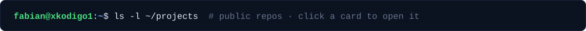
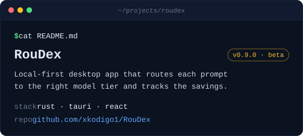
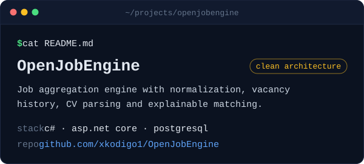
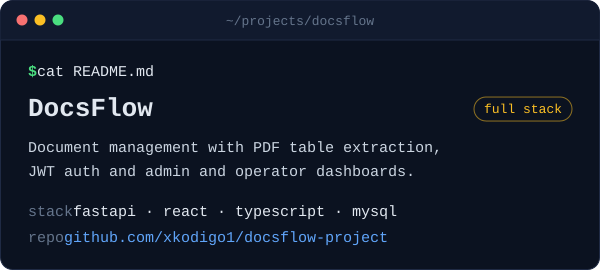
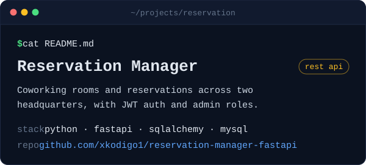
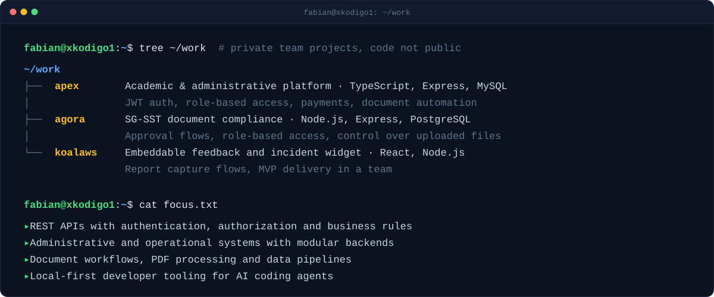
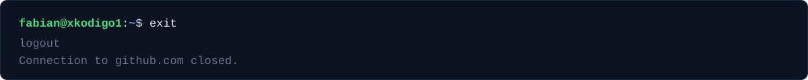

  

  <a href="https://linkedin.com/in/xkodigo1"><code>~/linkedin</code></a>&nbsp;&nbsp;
  <a href="mailto:xkodigo1@gmail.com"><code>~/email</code></a>&nbsp;&nbsp;
  <a href="https://github.com/xkodigo1?tab=repositories"><code>~/repos</code></a>

  
  

  
  

